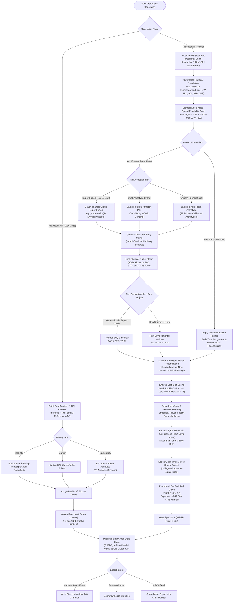

# Madden NFL Draft Class Generator (Madden 26 & 27)

Build, customize, and export authentic draft classes directly into **Madden NFL 27** and **Madden NFL 26**.

The app supports two powerful generation modes:
1. **Real NFL Drafts (1936 to 2026)**: Turn any historical draft class into a playable `.mdc` file - real players, rated from their actual NFL careers, with era-correct builds, gear, faces, and real drafting teams.
2. **Procedural / Fictional Draft Classes with the Freak Lab**: Generate unlimited fictional draft classes powered by a procedural variance engine ported and calibrated directly from the legendary **NFL 2K5** prospect system. Includes 29 physical archetypes, 7 mythical 3-way super-fusions, dual-archetype hybrids, authentic rookie OVR scaling (best player <= 84 OVR), and realistic development trait curves.

**[Download the latest release](https://github.com/AMattHT/Madden-Draft-Generator/releases/latest) Madden-27-Draft-Class-Generator-Setup-1.4.2.exe**


*A class opens blind. Every overall, dev trait and attribute reads `?` until you decide otherwise - so you can scout and draft without spoilers.*

---

## Player Generation Logic Flowchart

The following flowchart illustrates how both historical and procedural prospects are synthesized, correlated, balanced, and packaged into Madden binary `.mdc` files. For the in-depth technical specification, see [**docs/player-generation-pipeline.md**](docs/player-generation-pipeline.md).



---

## What It Does

### 1. Real NFL History (1936 to 2026)
- **The whole draft, not just the first round**: 32,140 real players across 91 drafts. When a year has more players than Madden's 402 slots - 1987 had 554 - you're shown exactly who didn't make the cut and can pull any player back in.
- **Ratings that mean something**: A player's overall comes from actual NFL career value (wAV), combine results, and historical production, matching Madden's in-game formula.
- **Real faces and real photographs**: 2,803+ players receive in-game head scans. 8,101+ have real photographs pulled from Madden archives back to 2001.

### 2. The Freak Lab: Procedural Prospect Variance Engine
Ported and calibrated directly from the **NFL 2K5** prospect variance engine:
- **29 Position-Gated Freak Archetypes**: Megatron alien receivers, Goliath dual-threat QBs, Sub-4.3 speed demons, Immovable Mountain maulers & nose tackles, Apex edge benders, and Tower-burner cornerbacks.
- **7 Hand-Curated 3-Way Super-Fusions**: Mythical combinations (e.g., Cam Newton x Josh Allen x Michael Vick at QB; Bo Jackson x Derrick Henry x Chris Johnson at HB; Tariq Woolen x Sauce Gardner x Deion Sanders at CB).
- **Dual-Archetype Hybrids**: Symmetric natural and stretch compatibility graphs with 70/30 primary/secondary body and attribute blending.
- **Multivariate Athletic Covariance**: Correlated body sizing and physical traits via a 6x6 Cholesky matrix with quantile-anchored sampling.
- **Biomechanical Mass-Speed Floor**: Enforces `t_40,min(W) = 4.22 + 0.0038 * max(0, W - 200)`, ensuring heavy prospects cannot sprint physically impossible 40 times.
- **Authentic Rookie OVR Ceilings**: The best player in a class is capped at **`83` or `84 OVR`**. Late-round freaks remain in their draft-round bands (`60-71 OVR`) as raw physical projects with high physical floors (90-99) but raw developmental instincts (`48-62` AWR/PRC).
- **Procedural Dev Trait Distribution**: Bell-curved allocation (**2-3 X-Factors, 6-8 Superstars, 35-42 Stars, ~355 Normal**), replacing the completed-career step wall.
- **4 Calibrated Presets**:
  - `Balanced` (Default): ~4% freaks (cap 16), 1-2 per draft.
  - `Freak Show`: ~10% freaks (cap 40), 2-4 per draft round.
  - `Super Fusions`: ~8% freaks (cap 32), higher rate of mythical 3-way blends.
  - `All Freaks`: 100% of the class rolled as freaks, hybrids, and fusions.

### 3. Fictional Likeness & Visual Isolation
- **Strict Real-Player & Jersey Isolation**: Procedural rookies are barred from inheriting active NFL head scans or portraits wearing NFL team jerseys.
- **1,305 3D Head Models**: Procedural prospects draw from Madden's generic heads plus 314 fictional 3D head models (`PlayerHead_*`).
- **991 Clean White-Jersey Rookie Portraits**: Assigned from `m27-generic-portrait-catalog.json`, ensuring every prospect wears a neutral rookie draft jersey matching their skin tone and face build.
- **Preserved Body Skin Tone**: Explicitly serialized in the visual JSON block to ensure flawless neck-to-body tone transitions in both Madden 26 and Madden 27.

### 4. Blind Scouting & Class Studio
- **Blind scouting**: Classes start with ratings, dev traits, and attributes masked (`?`). Toggle **Spoilers** when you want full visibility.
- **Three rating lenses for historical drafts**:
  - *Realistic*: Rates players as draft boards saw them at the time, with a hindsight slider.
  - *Career*: Rates players purely on their lifetime NFL accomplishments.
  - *Launch Day*: Uses EA's official rookie launch overalls and ratings across 23 supported seasons.
- **Class Studio**: Build custom all-time drafts, decade mixes, or custom draft boards with drag-and-drop reordering. Export any class to a spreadsheet with all 54 attributes.

---

## Installation & Setup

1. Download the **Setup** `.exe` from the [Releases](https://github.com/AMattHT/Madden-Draft-Generator/releases/latest) page (or use the portable version).
2. If Windows SmartScreen appears, click **More info -> Run anyway** (the app is not code-signed).
3. Launch **Madden 27 Draft Class Generator** from the Start menu.
4. On first launch, the app downloads historical NFL career and combine data. Classes generated before downloads finish are marked *degraded* - regenerate once complete.

### Local Development

```bash
# Clone the repository
git clone https://github.com/taylptrsn/Madden-Draft-Generator.git
cd Madden-Draft-Generator

# Install dependencies
npm --prefix server install
npm --prefix web install

# Run backend server
npm --prefix server run dev

# Run frontend UI
npm --prefix web run dev
```

---

## Exporting to Madden

1. Click **Export -> Save to Madden Saves**. The app writes the `.mdc` file directly into your Madden Saves directory (`%USERPROFILE%\Documents\Madden NFL 27\settings\` or `Madden NFL 26`).
2. Alternatively, download the `.mdc` file manually.
3. In Madden: Enter your Franchise, select **Scouting -> Choose Draft Class**, and pick your generated class.
