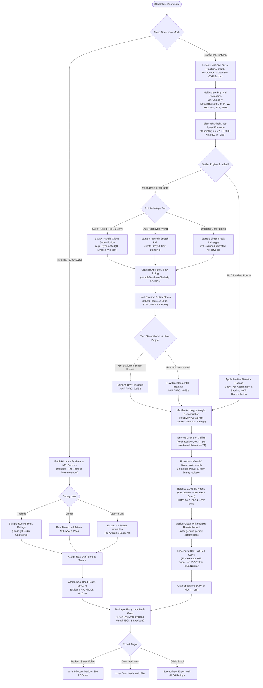

# Player Generation Pipeline & Architecture

This document details the end-to-end player generation architecture in the **Madden Draft Class Generator**, encompassing both **Historical Draft Classes (1936?2026)** and **Procedural / Fictional Draft Classes** powered by the **Outlier Engine** variance engine.

---

## 1. High-Level Generation Flowchart

---

## 2. Detailed Pipeline Steps

### 2.1 Positional Board Allocation & Slot Targets
Every draft class contains exactly **402 prospect slots** matching Madden's internal engine requirement (7 rounds $	imes$ 32 teams $+$ 178 undrafted priority free agents).
- Positions are allocated according to real NFL draft distributions across offense, defense, and specialists.
- Specialists (`K`, `P`, `FB`, `LS`) are systematically gated out of the first three rounds (`draftPick >= 115`) to prevent unrealistic top-50 kicker picks.
- Base target overalls decrease smoothly from Round 1 (`78?82 OVR`) through Round 7 (`60?66 OVR`) and Priority Free Agency (`55?62 OVR`).

### 2.2 Multivariate Physical Correlation (Cholesky Matrix)
Physical traits do not vary independently. The generator models realistic human body and athletic covariance using a $6 	imes 6$ empirical correlation matrix covering:
$$\mathbf{X} = [	ext{Height}, 	ext{Weight}, 	ext{Speed}, 	ext{Agility}, 	ext{Strength}, 	ext{Jumping}]$$

$$\mathbf{R} = egin{pmatrix}
 1.00 &  0.55 & -0.25 & -0.35 &  0.40 &  0.05 \
 0.55 &  1.00 & -0.60 & -0.65 &  0.75 & -0.45 \
-0.25 & -0.60 &  1.00 &  0.75 & -0.30 &  0.65 \
-0.35 & -0.65 &  0.75 &  1.00 & -0.40 &  0.60 \
 0.40 &  0.75 & -0.30 & -0.40 &  1.00 & -0.10 \
 0.05 & -0.45 &  0.65 &  0.60 & -0.10 &  1.00
\end{pmatrix}$$

Using the Cholesky factor $\mathbf{L}$ where $\mathbf{R} = \mathbf{L}\mathbf{L}^T$, standard normal draws $\mathbf{z} \sim \mathcal{N}(0, \mathbf{I})$ are transformed into correlated physical deviations $\mathbf{y} = \mathbf{L}\mathbf{z}$.

### 2.3 Biomechanical Mass-Speed Feasibility Floor
To prevent physically impossible archetypes (such as a 360-pound defensive tackle sprinting a 4.25-second 40-yard dash), the generator enforces a biomechanical feasibility curve derived from NFL Combine historical records:
$$t_{40, \min}(W) = 4.22 + 0.0038 	imes \max(0, W - 200)$$
- A 200-lb defensive back can achieve a $4.22	ext{s}$ forty.
- A 230-lb running back (Bo Jackson) has a feasibility floor of $4.33	ext{s}$.
- A 341-lb defensive tackle (Jordan Davis) has a feasibility floor of $4.76	ext{s}$.
If a hybrid or super-fusion rolls a 40-yard dash time faster than this physical limit, the time and Madden in-game `speed` rating are automatically capped to the biomechanically feasible maximum.

### 2.4 The Outlier Engine Variance Engine
Ported and calibrated directly from the audited NFL 2K5 prospect variance engine:
- **29 Position-Gated Archetypes**: Covering all positions (e.g., Megatron alien wideout, Goliath dual-threat QB, Sub-4.3 speed demon, Immovable Mountain mauler/nose tackle, Apex edge bender, Tower-burner cornerback).
- **7 Hand-Curated 3-Way Super-Fusions**: Forming complete 3-clique triangles with 100% position coverage (restricted to picks in the top 16).
- **Symmetric Natural & Stretch Hybrid Graphs**: Dual-archetype hybrids with $70/30$ primary/secondary body and attribute blending.
- **Quantile-Anchored Body Sizing (`sampleBand`)**: Sizing windows map the prospect's underlying Cholesky standard-normal draw $z$ to the archetype height/weight range via the standard normal CDF with $\pm 0.15$ natural jitter:
$$u = 	ext{clamp}_{[0, 1]}\left(\Phi(z) + \mathcal{U}(-0.15, 0.15)
ight)$$
$$	ext{Dimension} = 	ext{round}\left(	ext{min} + u 	imes (	ext{max} - 	ext{min})
ight)$$

### 2.5 Generational vs. Raw Project Instinct Split
In authentic draft classes, physical freaks outside the top of the draft are typically raw developmental projects rather than polished day-1 stars:
- **Generational / Super-Fusion Freaks** (Top-16 picks): Enter with high instincts (`awareness: 72?82`, `playRecognition: 72?82`).
- **Raw Project Freaks** (Mid-to-late round Unicorns & Hybrids): Enter with raw developmental instincts (`awareness: 48?62`, `playRecognition: 48?62`). Their draft-slot OVR budget is concentrated into their outlier physical traits and combine athleticism.

### 2.6 Archetype-Weighted OVR Reconciliation
To prevent freak ratings from inflating overall to game-breaking levels:
1. Physical outlier traits (Speed, Acceleration, Agility, Jumping, Strength, Throw Power, Hit Power) are **strictly locked** at their $90?99$ floors.
2. Technical skill floors (route running, coverage, blocking) scale relative to the rookie's draft-slot target OVR.
3. The engine computes Madden's official positional archetype weights and iteratively adjusts non-locked technical ratings so that **no eligible archetype scores higher than `targetOvr`**.
4. The highest-rated rookie in the entire draft class is capped at **`83` or `84 OVR`**, preserving realistic franchise mode progression.

### 2.7 Visual & Likeness Assembly
Procedural rookies must feel authentic without breaking immersion:
- **Strict Real-Player & Jersey Isolation**: Procedural rookies are barred from inheriting active NFL head scans or portraits wearing NFL team jerseys.
- **1,305 3D Head Catalog**: Procedural prospects draw from Madden's generic heads plus 314 fictional 3D head models (`PlayerHead_*`).
- **991 Clean White-Jersey Rookie Portraits**: Portraits are assigned from `m27-generic-portrait-catalog.json`, ensuring every prospect wears a neutral rookie draft jersey matching their skin tone and face build.
- **Skin Tone Preservation**: Body skin tones are explicitly encoded in the visual JSON block to ensure seamless neck-to-body tone transitions in both Madden 26 and Madden 27.

### 2.8 Procedural Development Trait Rebalancing
Rather than the historical step-wall, procedural classes feature an authentic NFL rookie development trait distribution:
- **X-Factor (3)**: 2 to 3 prospects (reserved for top generational freaks or top overall picks).
- **Superstar (2)**: 6 to 8 prospects (spread across Round 1 and premier freaks).
- **Star (1)**: 35 to 42 prospects (distributed across Rounds 1?5).
- **Normal (0)**: ~350+ prospects (including standard-development players in Round 1).

### 2.9 Binary `.mdc` File Packaging
The draft class is compiled into Madden's proprietary `.mdc` container format:
- Attribute data block formatted to Madden 26 / 27 bit-level specifications.
- 5,632-byte zero-padded, uncompressed JSON visual block containing body type, 3D head model, loadout equipment, and skin tone.
- Written directly to `%USERPROFILE%\Documents\Madden NFL 27\settings\` (or Madden 26) with CRC-32 integrity validation.
